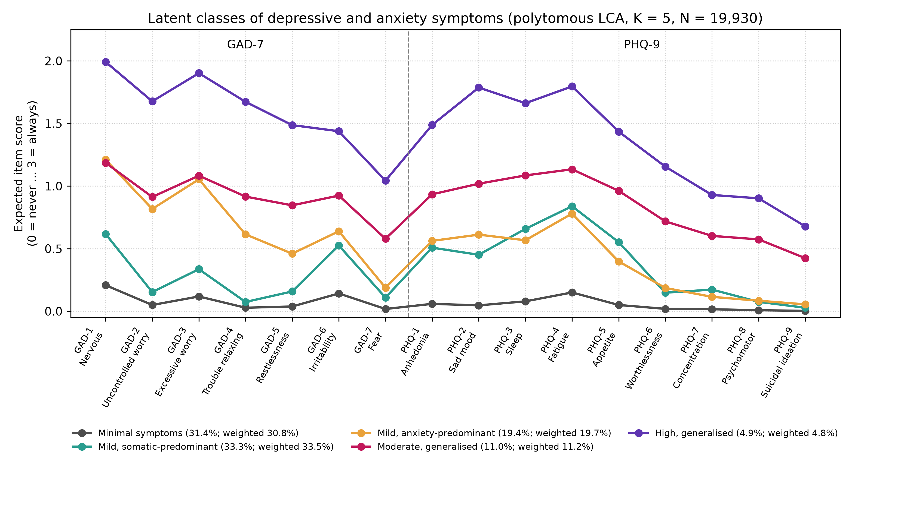

# Depression and anxiety symptom heterogeneity among women in Bangladesh (BDHS 2022)

Reproducible analysis code for the article *"Heterogeneity in depressive and anxiety symptoms among ever-married women in Bangladesh: Complementary latent class and symptom-network analyses of the 2022 Demographic and Health Survey"* (manuscript under review; the citation will be added on publication).

The code applies **latent class analysis (LCA)** and **psychological network analysis** to the **PHQ-9** (depression) and **GAD-7** (anxiety) items of the nationally representative **2022 Bangladesh Demographic and Health Survey** (N = 19,930 ever-married women aged 15–49). It then estimates sociodemographic correlates of class membership with **survey-weighted, bias-adjusted three-step (BCH)** models.

**Keywords:** depression · anxiety · PHQ-9 · GAD-7 · latent class analysis · network analysis · women's mental health · Bangladesh · Demographic and Health Survey (DHS)

## Main results (survey-weighted)
- **Five latent classes:** minimal symptoms (30.8%), mild somatic-predominant (33.5%), mild anxiety-predominant (19.7%), moderate generalised (11.2%) and high generalised (4.8%).
- **Network:** *trouble relaxing* (GAD-4) has the highest strength centrality, and *fear* (GAD-7) the highest bridge strength between the PHQ-9 and GAD-7 items. CS-coefficients are 0.75.
- **Correlates:** older age and being widowed, divorced or separated are the most consistent correlates of membership in the higher-symptom classes.



## Methods implemented
- Polytomous **latent class analysis** (StepMix) for K = 1–7: BIC, SABIC, CAIC, entropy, AvePP, **bootstrap likelihood-ratio test**, best-log-likelihood replication, level-versus-shape decomposition, bivariate residuals, a survey-weighted LCA and PSU-bootstrap CIs.
- **Psychological network analysis:** polychoric correlations plus **EBICglasso** (graphical lasso with EBIC tuning, following `qgraph`/`bootnet` defaults); strength, expected influence and **bridge strength**; 1,000 nonparametric bootstraps; case-dropping **CS-coefficients**; bootstrapped difference tests. Implemented in Python.
- **Correlates:** survey-weighted multinomial logistic regression with Taylor-linearised cluster-robust SEs; **BCH three-step** correction for classification error with a stratified PSU bootstrap; GVIF collinearity diagnostics.

## Quick start
```bash
git clone <this repository>
cd bdhs2022-depression-anxiety-lca-network
python3.12 -m venv .venv && .venv/bin/pip install -r requirements.txt
# put BDIR81FL.DTA into data/ (see data/README.md)
PYTHON=.venv/bin/python N_JOBS=16 ./run_all.sh
```
Results are written to `results/` (tables as CSV, figures as PNG, LaTeX tables in `results/latex/`). [`docs/output_map.md`](docs/output_map.md) maps every table and figure of the article to its script and output file.

## Repository structure
```
analysis/   00–10, 13: analysis pipeline (run in order by run_all.sh); common.py: shared functions
data/       instructions for obtaining the BDHS 2022 data (data not included)
results/    aggregate result tables (CSV) and figures (PNG) from the verified run
docs/       output map and reproducibility report
```

## Reproducibility
Fixed seeds and pinned package versions make results identical across runs. A clean re-run reproduced every result table of an earlier run exactly; see [`docs/reproducibility.md`](docs/reproducibility.md). Runtime is about 2 hours on 16–20 cores.

## Data
BDHS 2022 data are available free of charge to registered users from the [DHS Program](https://dhsprogram.com). They cannot be redistributed, so no microdata or individual-level files are included here (enforced by `.gitignore`).

## AI assistance
The analysis code was developed with the assistance of a generative AI coding assistant (Claude Opus 5.5, Anthropic) under the authors' direction, as disclosed in the article.

## License and citation
Code: [MIT License](LICENSE). Please cite the article when using this code; see [`CITATION.cff`](CITATION.cff) (GitHub's "Cite this repository" button).
